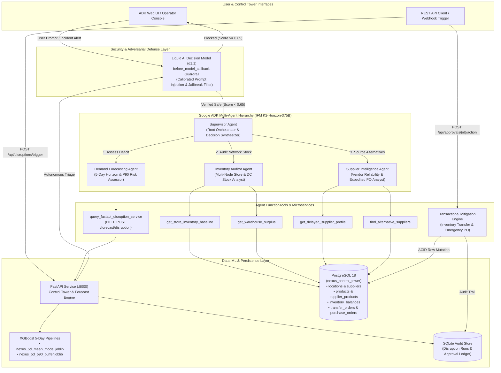
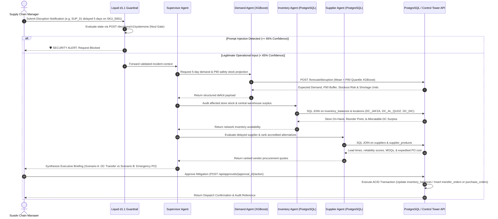

# NEXUS Control Tower — Autonomous Supply Chain Multi-Agent Orchestration

**NEXUS Control Tower** is an end-to-end autonomous supply chain disruption resolution platform built with **Google Agent Development Kit (ADK)**, **IFM K2-Horizon (375B-A23B)**, **Liquid AI Decision Models (`d1.1`)**, **XGBoost Probabilistic Demand Forecasting**, **FastAPI**, and **PostgreSQL**.

When a supply chain disruption occurs (such as a vendor delay or logistics bottleneck across UAE retail stores and distribution centers), NEXUS orchestrates specialized AI agents to predict stockout risk at the 90th percentile (P90), audit real-time warehouse and store inventory, negotiate emergency purchase order quotes with alternative suppliers, and execute human-in-the-loop transactional mitigations.

---

## System Architecture



---

## End-to-End Disruption Resolution Workflow



---

## Key Capabilities

1. **Multi-Agent Orchestration with Google ADK & K2-Horizon**:
   - **Supervisor Agent** (`src/agents/supervisor_agent.py`): Coordinates root triage, delegates tasks across sub-agents, compares recovery scenarios (Warehouse Transfer vs. Expedited Vendor PO), and produces an actionable approval card.
   - **Demand Forecasting Agent** (`src/agents/demand_agent.py`): Calls the local FastAPI XGBoost microservice to predict 5-day expected sales and 90th-percentile (`P90`) safety demand buffers.
   - **Inventory Auditor Agent** (`src/agents/inventory_agent.py`): Queries live PostgreSQL tables for store-level stock baselines and distribution center (`DC_JAFZA`, `DC_AL_QUOZ`, `DC_DIC`) allocatable surplus above safety thresholds.
   - **Supplier Intelligence Agent** (`src/agents/supplier_agent.py`): Audits vendor reliability, lead-time penalties, minimum order quantities (MOQs), and total landed procurement costs in AED.

2. **Liquid AI (`d1.1`) Pre-Execution Security Guardrail**:
   - Implemented via Google ADK's `before_model_callback` (`src/agents/decision_callback.py`).
   - Evaluates incoming prompts in a single forward pass using calibrated probabilities (`Noul` question type) to block prompt injection, jailbreaking, and instruction overriding before reaching the LLM.

3. **Live PostgreSQL Transactional State & SQLite Audit Store**:
   - Seeded with UAE retail network topology: **23 locations** (20 stores + 3 distribution centers), **15 suppliers**, **495 products**, **990 supplier-product contracts**, and **11,385 inventory balances**.
   - Human-in-the-loop approvals trigger real ACID row mutations (`execute_inventory_transfer_sql` and `execute_emergency_po_sql` in `src/agents/db.py`), deducting warehouse stock, incrementing in-transit store inventory, and recording `transfer_orders` or `purchase_orders`.

---

## Repository Structure

```text
nexus-forecasting/
├── data/
│   └── synthetic/                  # UAE Retail synthetic relational CSVs for seeding
│       ├── locations.csv
│       ├── suppliers.csv
│       ├── products.csv
│       ├── supplier_products.csv
│       └── inventory_balances.csv
├── models/                         # Trained 5-day XGBoost forecasting pipelines
│   ├── nexus_5d_mean_model.joblib
│   └── nexus_5d_p90_buffer.joblib
├── scripts/                        # PostgreSQL DDL schema & automated seeding utility
│   ├── init_control_tower_db.sql
│   └── seed_postgres.py
├── src/
│   ├── agents/                     # Google ADK multi-agent system
│   │   ├── tools/                  # FunctionTools for Demand, Inventory, and Supplier agents
│   │   ├── agent.py                # ADK root_agent entrypoint
│   │   ├── config.py               # LiteLLM K2-Horizon setup & multi-turn reasoning patch
│   │   ├── db.py                   # SQLAlchemy PostgreSQL query & ACID transaction layer
│   │   ├── decision_callback.py    # Liquid d1.1 prompt injection guardrail
│   │   ├── demand_agent.py         # Demand Forecasting Agent
│   │   ├── inventory_agent.py      # Inventory Auditor Agent
│   │   ├── supplier_agent.py       # Supplier Intelligence Agent
│   │   └── supervisor_agent.py     # Root Supervisor Agent
│   ├── api/                        # FastAPI Control Tower & Forecast Engine
│   │   ├── control_tower.py        # Disruption trigger & manager approval endpoints
│   │   ├── main.py                 # FastAPI entrypoint & CORS middleware
│   │   ├── schemas.py              # Pydantic request/response schemas
│   │   ├── scoring.py              # Mitigation option ranking (cost, speed, reliability)
│   │   ├── service.py              # XGBoost inference engine
│   │   └── store.py                # SQLite control tower state & approval persistence
│   ├── build_5day_features.py      # 5-day rolling lag & price feature engineering
│   ├── preprocessing.py            # M5 raw data transformation pipeline
│   ├── feature_engineering.ipynb   # Exploratory feature engineering notebook
│   ├── seasonal_baseline.ipynb     # Baseline seasonal benchmark notebook
│   └── train_test.ipynb            # XGBoost Mean & P90 Quantile training notebook
├── tests/
│   └── test_control_tower_api.py   # End-to-end API & mitigation execution tests
├── .env.example                    # Environment variable template
├── pyproject.toml                  # Project dependencies (uv / PEP 621)
└── README.md
```

---

## Quick Start Guide

### 1. Prerequisites & Environment Setup

Clone the repository and install dependencies using `uv` (or `pip`):

```bash
git clone https://github.com/akhi-lbj/Supply-Chain-Multi-Agent-Orchestration.git
cd Supply-Chain-Multi-Agent-Orchestration
uv sync
```

Copy `.env.example` to `.env` and populate your API credentials:

```bash
cp .env.example .env
```

| Variable | Description |
| :--- | :--- |
| `IFM_API_KEY` | API key for IFM K2-Horizon (`IFM/K2-Horizon-375B-A23B`) |
| `IFM_API_BASE` | `https://api.ifm.ai/v1` |
| `LFM_API` | Liquid AI API key for `d1.1` decision guardrail (`https://api.liquid.ai/decisions`) |
| `DATABASE_URL` | PostgreSQL connection string (`postgresql://postgres:<password>@127.0.0.1:5432/nexus_control_tower`) |
| `LANGFUSE_SECRET_KEY` | *(Optional)* Langfuse OpenTelemetry tracing secret key |
| `LANGFUSE_PUBLIC_KEY` | *(Optional)* Langfuse OpenTelemetry tracing public key |

---

### 2. Initialize & Seed PostgreSQL

Ensure PostgreSQL is running locally, then run the automated seeding script to apply `scripts/init_control_tower_db.sql` and bulk-load the UAE retail dataset:

```bash
python scripts/seed_postgres.py
```

*(Note: If PostgreSQL is unavailable, `src/agents/db.py` automatically falls back to reading `data/synthetic/*.csv` so agents remain operational in offline environments.)*

---

### 3. Start the FastAPI Forecasting & Control Tower Server

Launch the FastAPI microservice on port `8000` (required by the Demand Forecasting Agent and REST Control Tower endpoints):

```bash
uvicorn src.api.main:app --host 127.0.0.1 --port 8000 --reload
```

Interactive Swagger docs are available at `http://127.0.0.1:8000/docs`.

---

### 4. Launch the Google ADK Web Interface

In a second terminal, start the interactive Google ADK Web UI on port `8080`:

```bash
adk web src --port 8080
```

Open `http://127.0.0.1:8080` in your browser, select the `agents` app, and submit a sample disruption notification:

> *"URGENT INCIDENT NOTIFICATION: Supplier SUP_01 has announced a 5-day supply delay affecting SKU_0001 at store STR_DXB_01. Please run the full disruption resolution protocol."*

---

## REST API Endpoints

| Method | Endpoint | Description |
| :--- | :--- | :--- |
| `GET` | `/health` | Health check and XGBoost artifact status |
| `POST` | `/forecast/disruption` | Execute 5-day Mean & P90 safety demand forecast for affected SKUs |
| `POST` | `/api/disruptions/trigger` | Trigger full multi-agent disruption analysis and generate ranked mitigation options |
| `GET` | `/api/disruptions` | List all active and historical disruption incidents and approval cards |
| `POST` | `/api/approvals/{approval_id}/action` | Approve, modify, or reject a proposed mitigation and commit PostgreSQL transactions |
